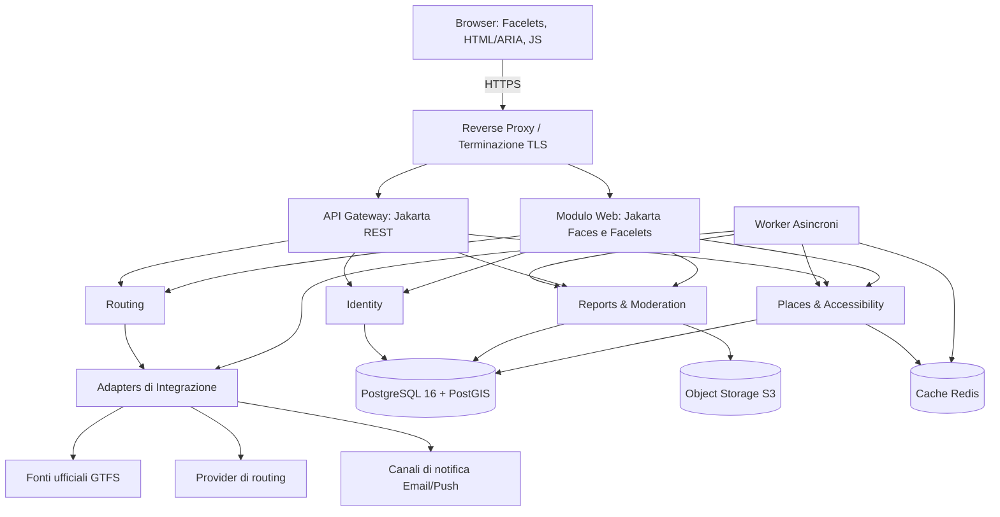
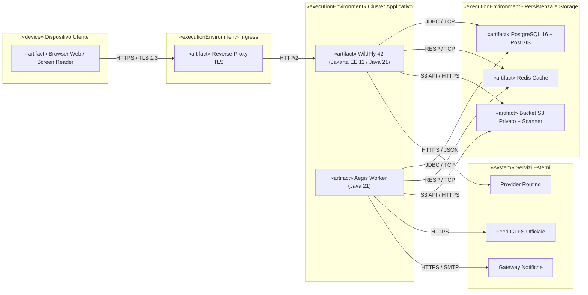
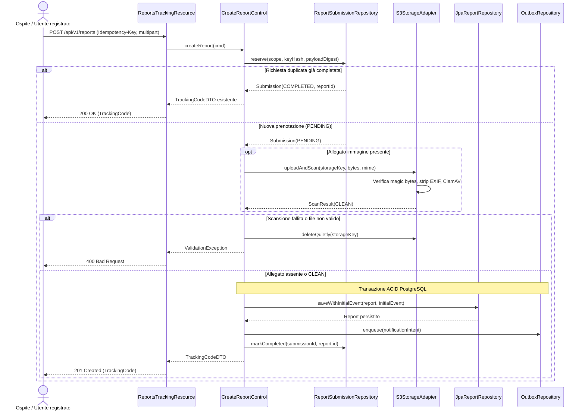
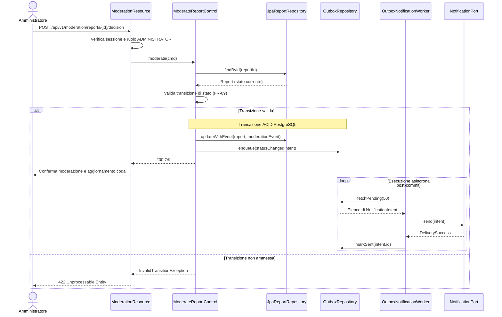

# SDD

## Documento di Progettazione del Sistema

| Dato | Valore |
|---|---|
| Progetto | Aegis |
| Corso | Ingegneria del Software e Interazione Uomo-Macchina |
| Docenti | Prof.ssa Mariacarla Staffa |
| Candidati | Alessio Attilio, Michela Rita Brancaccio, Andrea Plini |
| Anno accademico | 2025/2026 |

## SOMMARIO

1. Introduzione
   - 1.1 Scopo del sistema
   - 1.2 Obiettivi di progettazione
   - 1.3 Definizioni, acronimi e abbreviazioni
   - 1.4 Riferimenti
   - 1.5 Panoramica
2. Sistema corrente
3. Sistema proposto
   - 3.1 Panoramica
   - 3.2 Decomposizione del sistema
     - 3.2.1 Diagramma dei moduli
   - 3.3 Hardware/software mapping
   - 3.4 Gestione dei dati persistenti
     - 3.4.1 PostgreSQL e struttura relazionale
     - 3.4.2 Object storage
     - 3.4.3 Meccanismi di sincronizzazione
   - 3.5 Controllo accessi e sicurezza
     - 3.5.1 Autenticazione e identità
     - 3.5.2 Controllo degli accessi ai dati
     - 3.5.3 Gestione delle immagini
     - 3.5.4 Protezione da abusi
   - 3.6 Decisioni sul flusso di controllo globale
     - 3.6.1 Gestione della sessione utente
     - 3.6.2 Navigazione tra viste
     - 3.6.3 Gestione asincrona ed eventi
     - 3.6.4 Gestione degli errori
   - 3.7 Condizioni limite
4. Servizi del sottosistema
   - 4.1 Autenticazione utente
   - 4.2 Gestione dei luoghi
   - 4.3 Informazioni di accessibilità
   - 4.4 Pianificazione dei percorsi
   - 4.5 Segnalazioni e moderazione
   - 4.6 Geolocalizzazione, sincronizzazione e notifiche
5. Diagrammi di progettazione
   - 5.1 Diagramma delle classi di design
   - 5.2 Diagrammi di sequenza di design
6. Glossario

---

## INTRODUZIONE

### 1.1 SCOPO DEL SISTEMA

Questo documento descrive l’architettura software di **Aegis** e dettaglia i sottosistemi, i modelli dati, le interfacce e le decisioni progettuali che realizzano i requisiti funzionali e non funzionali definiti nel Documento di Analisi dei Requisiti (RAD).

### 1.2 OBIETTIVI DI PROGETTAZIONE

| Obiettivo | Criterio architetturale |
|---|---|
| Separazione delle responsabilità | Mantenere distinti dominio, casi d’uso e adattatori tramite architettura esagonale (*Ports & Adapters*). |
| Affidabilità dei dati di accessibilità | Registrare fonte e freschezza. Trattare come sconosciuti i dati assenti o aggiornati da più di 30 giorni. |
| Sostituibilità delle integrazioni | Collegare fonti GTFS, provider di routing, storage e canali di notifica tramite porte e adattatori isolati. |
| Tracciabilità della moderazione | Conservare gli eventi decisionali in forma *append-only* nella stessa transazione dell’aggiornamento di stato. |
| Sicurezza e privacy | Applicare autorizzazione server-side (RBAC), minimizzazione dei dati personali (GDPR) e scansione degli upload. |
| Operatività misurabile | Registrare esiti di sincronizzazione, ritardi delle fonti, errori e stato dei processi asincroni mediante log strutturati e metriche. |

*Tabella 1.1: Obiettivi di progettazione e relativi criteri architetturali*

### 1.3 DEFINIZIONI, ACRONIMI E ABBREVIAZIONI

| Termine | Significato |
|---|---|
| API | Interfaccia di programmazione applicativa esposta via HTTP/HTTPS. |
| DTO | *Data Transfer Object*, oggetto di trasferimento usato ai confini applicativi. |
| SRID | *Spatial Reference System Identifier*, identificatore del sistema di riferimento spaziale (WGS84 / EPSG:4326). |
| PostGIS | Estensione spaziale del database relazionale PostgreSQL. |
| Jakarta EE | Piattaforma Enterprise Java di riferimento: Jakarta EE 11 con Java SE 21 LTS e application server WildFly 42. |
| Jakarta Faces | Framework Jakarta EE per interfacce server-side basate su componenti. |
| Facelets | Tecnologia di viste XHTML accessibili usata da Jakarta Faces. |
| Jakarta REST | API Jakarta EE per l’esposizione di risorse HTTP RESTful. |
| Dato sconosciuto | Informazione assente, scaduta (> 30 giorni) o incoerente che non permette di determinare l’accessibilità. |

*Tabella 1.2: Definizioni, acronimi e abbreviazioni*

### 1.4 RIFERIMENTI

| Riferimento | Ruolo nel progetto |
|---|---|
| RAD – Documento di Analisi dei Requisiti (Aegis) | Specifica completa di requisiti funzionali, non funzionali, attori, casi d’uso e vincoli di dominio. |
| Jakarta EE 11 e Java SE 21 LTS | Piattaforma applicativa backend e runtime di esecuzione su server WildFly 42. |
| PostgreSQL 16 e PostGIS 3.4 | DBMS relazionale ed estensione geospaziale per la persistenza. |
| WCAG 2.1 livello AA | Baseline tecnica di accessibilità adottata per tutte le viste web e i flussi utente. |
| Regolamento (UE) 2016/679 (GDPR) e Legge 4/2004 | Quadro normativo per protezione dei dati personali e accessibilità degli strumenti informatici. |
| Specifica OpenAPI 3.1 | Contratto formale delle API REST esposte dal sistema. |

*Tabella 1.3: Riferimenti tecnici e normativi*

### 1.5 PANORAMICA

Il documento è organizzato in 6 capitoli: il Capitolo 1 definisce scopo e obiettivi di progettazione; il Capitolo 2 inquadra l’assenza di sistemi preesistenti (*greenfield*); il Capitolo 3 descrive l’architettura proposta, la decomposizione in moduli, il mapping hardware/software, la persistenza, la sicurezza e il flusso di controllo; il Capitolo 4 specifica i servizi dei sottosistemi; il Capitolo 5 presenta i diagrammi UML di design (classi e sequenze); il Capitolo 6 raccoglie il glossario tecnico.

## SISTEMA CORRENTE

Il progetto è di tipo **greenfield** (sviluppo ex novo): non esiste un sistema preesistente da migrare o integrare come legacy. L’architettura viene progettata da zero per acquisire i feed ufficiali GTFS del trasporto pubblico locale dell’area metropolitana di Napoli e affiancarli alle segnalazioni georeferenziate degli utenti.

## SISTEMA PROPOSTO

### 3.1 PANORAMICA

**Aegis** è una web app responsive progettata secondo un’architettura a livelli disaccoppiata (*Domain*, *Application*, *Adapters*). Le viste web server-side sono realizzate con **Jakarta Faces** e **Facelets**, mentre le API HTTP/JSON sono esposte tramite **Jakarta REST** su runtime **Java SE 21 LTS / Jakarta EE 11 (WildFly 42)**. La persistenza transazionale e geospaziale è affidata a **PostgreSQL 16 con PostGIS 3.4**, la cache di lettura a **Redis**, l’archiviazione delle immagini a uno storage compatibile **S3** e le operazioni asincrone (importazioni GTFS, riconciliazione upload e invio notifiche) a **worker Java dedicati**.

Il browser riceve markup HTML semantico e accessibile (WCAG 2.1 AA) per le viste e payload JSON dalle API REST. La mappa interattiva utilizza una libreria cartografica client-side affiancata da una vista tabellare/testuale equivalente sincronizzata sugli stessi dati. La consultazione pubblica, l’invio di segnalazioni e il tracking tramite codice sono accessibili all’Ospite senza registrazione (protetti da rate limiting e idempotenza), mentre preferiti, notifiche, storico personale e pannello di moderazione richiedono autenticazione e verifica dei ruoli lato server.

### 3.2 DECOMPOSIZIONE DEL SISTEMA

La tabella seguente mappa i moduli architetturali sui requisiti funzionali, non funzionali e casi d’uso del RAD.

| Modulo | Responsabilità architetturale | Requisiti funzionali e casi d’uso | Requisiti di qualità |
|---|---|---|---|
| `places` | Gestire luoghi, fermate e stazioni ed eseguire ricerche geospaziali su PostGIS. | FR-01, FR-06, UC-02 | NFR-08, NFR-10 |
| `accessibility` | Gestire caratteristiche di accessibilità, stato, fonte, timestamp e regola di scadenza a 30 giorni. | FR-02, FR-03, UC-01, UC-02 | NFR-08 |
| `routing` | Validare richieste di viaggio, invocare il provider esterno e classificare l’incertezza dei tratti. | FR-04, FR-05, UC-01 | NFR-08, NFR-10 |
| `reports` | Gestire creazione idempotente delle segnalazioni, upload sicuro e tracking pubblico tramite codice non enumerabile. | FR-07, FR-08, UC-03, UC-04 | NFR-04, NFR-06, NFR-07 |
| `moderation` | Applicare i controlli di ruolo e validare le transizioni di stato conservando lo storico *append-only*. | FR-09, UC-05 | NFR-04, NFR-05, NFR-06 |
| `identity` | Gestire registrazione, autenticazione, sessioni, ruoli RBAC, preferiti e consensi alle notifiche. | FR-13, FR-14, FR-15, UC-05–UC-09 | NFR-04, NFR-05 |
| `integrations` | Implementare gli adattatori verso fonti GTFS, provider di routing, storage S3 e canali di notifica. | FR-10, FR-12, UC-01, UC-03, UC-05, UC-06 | NFR-07, NFR-12 |
| `worker` | Eseguire importazioni GTFS schedulate/manuali, pulizia cache, riconciliazione upload e invio notifiche dall’outbox. | FR-07, FR-10, FR-11, FR-12, UC-03, UC-05, UC-06 | NFR-07, NFR-09, NFR-10 |
| `web` | Fornire viste Facelets accessibili (WCAG 2.1 AA) con mappa, alternative testuali, moduli e pannello amministrativo. | FR-01–FR-09, FR-13–FR-15, UC-01–UC-09 | NFR-01, NFR-02, NFR-03, NFR-10, NFR-13 |

*Tabella 3.1: Decomposizione del sistema in moduli e tracciabilità verso il RAD*

Internamente, ciascun dominio applicativo è organizzato in tre package:

- `domain`: entità, value object immutabili, enumerazioni e regole di invariante pure (prive di dipendenze da framework).
- `application`: casi d’uso (`*Control`), coordinamento transazionale e porte (*interfaces*) verso persistenza e servizi esterni.
- `adapter`: implementazioni concrete per risorse Jakarta REST, controller Jakarta Faces, repository JPA/PostGIS, client HTTP e storage S3.

#### 3.2.1 DIAGRAMMA DEI MODULI

*Figura 3.1: Diagramma dei moduli e delle dipendenze architetturali*

### 3.3 HARDWARE/SOFTWARE MAPPING

| Nodo | Ambiente e software | Responsabilità |
|---|---|---|
| Dispositivo client | Browser desktop o mobile (Chrome, Firefox, Safari, Edge) e screen reader. | Renderizzare viste HTML/Facelets, interagire con mappa ed elenco testuale ed effettuare chiamate HTTPS. |
| Reverse Proxy / Ingress | Nginx / Load Balancer con terminazione TLS 1.3. | Gestire certificati HTTPS, instradare le richieste verso l’application server e applicare rate limiting perimetrale. |
| Application Server | Container Linux con Java SE 21 LTS, Jakarta EE 11 e WildFly 42. | Eseguire viste Jakarta Faces, endpoint Jakarta REST e logica dei casi d’uso. |
| Worker Node | Container Linux con runtime Java SE 21 LTS. | Eseguire sincronizzazioni GTFS, riconciliazione upload S3 e consumo asincrono di `notification_outbox`. |
| Database Server | PostgreSQL 16 con estensione spaziale PostGIS 3.4. | Persistenza relazionale e geospaziale (SRID 4326), vincoli di integrità e transazioni ACID. |
| Cache Server | Redis 7. | Memorizzare risultati di ricerca luoghi/accessibilità indicizzati per vettore di generazioni attive. |
| Object Storage | Servizio compatibile S3 (MinIO in sviluppo / AWS S3 in produzione) e ClamAV. | Archiviare in bucket privato le immagini allegate alle segnalazioni e scansionarle prima della pubblicazione. |
| Servizi esterni | Endpoint HTTPS di dataset GTFS, Provider di routing e Gateway notifiche. | Fornire dati ufficiali TPL, calcolo itinerari e recapito notifiche agli utenti consenzienti. |

*Tabella 3.2: Mappatura hardware/software dei nodi di sistema*

*Figura 3.2: Diagramma di deployment di Aegis*

In ambiente di sviluppo l’intera topologia è orchestrata tramite **Docker Compose** (WildFly, Worker, PostgreSQL/PostGIS, Redis, MinIO e ClamAV), mentre in produzione i container applicativi e worker sono eseguiti in modalità stateless dietro load balancer con backup automatici giornalieri del database e replicazione dello storage S3.

### 3.4 GESTIONE DEI DATI PERSISTENTI

La persistenza relazionale utilizza **PostgreSQL 16 con PostGIS 3.4**. Le migrazioni dello schema sono versionate tramite **Flyway** ed eseguite in modalità retrocompatibile. Le entità del package `domain` sono mappate sulle tabelle mediante adattatori JPA/Hibernate isolati nel layer `adapter`.

#### 3.4.1 POSTGRESQL E STRUTTURA RELAZIONALE

| Tabella | Contenuto, chiavi e vincoli principali |
|---|---|
| `place` | Luogo, fermata o stazione (`id` UUID PK, `name`, `place_type`, `geom` `GEOMETRY(Point, 4326)` con indice GiST). |
| `accessibility_feature` | Caratteristica di accessibilità (`id` UUID PK, `place_id` FK, `source_id` FK, `generation_id` FK, `feature_type`, `state`, `observed_at`, `valid_until`). |
| `data_source` | Fonte autorizzata (`id` UUID PK, `name`, `version`, `validity_days` default 30, `active_generation_id` FK). |
| `source_sync` | Registro sincronizzazioni (`id` UUID PK, `source_id` FK, `version`, `result`, `started_at`, `completed_at`, `error_detail`, `cache_cleaned` boolean). |
| `transit_line` | Linea di trasporto (`id` UUID PK, `external_id`, `name`, `source_id` FK, `generation_id` FK). |
| `transit_stop` | Fermata (`id` UUID PK, `place_id` FK, `geom` `GEOMETRY(Point, 4326)`, `source_id` FK, `generation_id` FK). |
| `report_submission` | Prenotazione idempotente dell’invio (`id` UUID PK, `client_scope`, `idempotency_key_hash`, `payload_digest`, `status`, `report_id` FK nullable, `created_at`). Vincolo `UNIQUE(client_scope, idempotency_key_hash)`. |
| `report` | Segnalazione (`id` UUID PK, `place_id` FK nullable, `author_id` FK nullable verso `user_account`, `duplicate_of_id` FK nullable, `category`, `description`, `geom` `GEOMETRY(Point, 4326)`, `status`, `tracking_code_hash` UNIQUE, `observed_at`, `created_at`). |
| `report_event` | Storico *append-only* (`id` UUID PK, `report_id` FK, `actor_id` FK nullable, `event_type`, `motivation`, `occurred_at`). Protetto da revoca dei permessi `UPDATE`/`DELETE` al ruolo applicativo. |
| `report_attachment` | Allegato foto (`id` UUID PK, `submission_id` FK, `report_id` FK nullable, `storage_key` UNIQUE, `mime_type`, `size_bytes`, `scan_result`, `state`, `created_at`). |
| `user_account` | Utente registrato o amministratore (`id` UUID PK, `email` UNIQUE, `password_hash`, `created_at`). |
| `user_role` | Ruoli assegnati (`user_id` FK, `role` enum `REGISTERED_USER` / `ADMINISTRATOR`, PK composta). |
| `favorite_place` | Luoghi seguiti dall’utente (`user_id` FK, `place_id` FK, `notifications_consent` boolean, `added_at`, PK composta). |
| `notification_outbox` | Coda transazionale delle notifiche (`id` UUID PK, `report_id` FK, `event_type`, `status`, `retry_count`, `next_attempt_at`, `created_at`). |

*Tabella 3.3: Schema relazionale e geospaziale in PostgreSQL/PostGIS*

**Minimizzazione e ciclo di vita dei dati (GDPR).** Le richieste di pianificazione percorso (UC-01) sono elaborate in memoria e non vengono salvate nel database; al provider esterno di routing sono inviate esclusivamente le coordinate/fermate di origine e destinazione e i vincoli di accessibilità tecnici, escludendo identificativi utente e codici di tracking. Nelle segnalazioni (`report`), l’eventuale `author_id` è separato dai campi pubblici ed escluso da tutte le risposte REST pubbliche e dalla pagina di tracking (NFR-04). I log applicativi mascherano automaticamente credenziali, token di tracking, coordinate puntuali e testi liberi delle segnalazioni.

#### 3.4.2 OBJECT STORAGE

Le immagini allegate alle segnalazioni (JPEG, PNG o WebP fino a 5 MB) sono archiviate in un bucket **S3 privato** (senza accesso anonimo diretto). Il flusso garantisce consistenza tra database e object storage senza richiedere transazioni distribuite:

1. **Prenotazione atomica:** prima di scrivere su S3, il sistema apre una transazione database che inserisce un record `PENDING` in `report_submission` (con chiave di idempotenza e digest SHA-256 del payload e dell’immagine) e un intento in `report_attachment` con una `storage_key` opaca (UUIDv4).
2. **Upload e scansione:** il file viene caricato nel bucket privato, verificato nei *magic bytes* (corrispondenza tra estensione, tipo MIME e firma binaria) e sottoposto a scansione antivirus tramite **ClamAV**.
3. **Commit finale:** solo se la scansione ha esito `CLEAN`, una seconda transazione database salva `report`, l’evento iniziale `CREATED` in `report_event`, collega `report_attachment` al `report_id` e marca `report_submission` come `COMPLETED`.
4. **Riconciliazione e pulizia:** se l’upload o la scansione falliscono (file infetto, corrotto o > 5 MB), l’oggetto viene eliminato o messo in quarantena e l’operazione è rifiutata senza lasciare segnalazioni parziali. Un job periodico del worker scansiona gli intenti `report_attachment` rimasti pendenti oltre 30 minuti ed elimina eventuali oggetti orfani su S3.

#### 3.4.3 MECCANISMI DI SINCRONIZZAZIONE

L’importazione dei dataset ufficiali **GTFS** (UC-06) avviene tramite un meccanismo di **pubblicazione atomica per generazioni** che impedisce letture parziali o incoerenti:

1. **Isolamento della generazione candidata:** il worker crea un record `source_sync` con stato `RUNNING` e importa fermate, linee e caratteristiche in una nuova `generation_id` isolata, non ancora referenziata da `data_source.active_generation_id`.
2. **Validazione integrale:** prima della pubblicazione, il worker verifica integrità dello schema GTFS, chiavi referenziali, validità delle coordinate nel bounding box urbano e soglie minime di completezza.
3. **Switch atomico:** se tutti i controlli superano la verifica, una singola transazione aggiorna `data_source.active_generation_id` alla nuova generazione e imposta `source_sync.result = SUCCESS` con `cache_cleaned = false`. In caso di errore, la transazione non modifica `active_generation_id`: i dati precedenti restano integralmente consultabili (NFR-09) e l’errore è registrato in `source_sync`.
4. **Coerenza della cache Redis:** ogni lettura acquisisce preliminarmente gli ID delle generazioni attive delle fonti coinvolte e costruisce la chiave cache includendo tale vettore di generazioni (`gen:<id1>-<id2>:area:<hash>`). Al commit di una nuova generazione, le chiavi precedenti diventano immediatamente non selezionabili; un task asincrono del worker provvede poi alla pulizia fisica delle chiavi obsolete e imposta `cache_cleaned = true`. Anche in caso di *cache hit*, il layer applicativo rivaluta sempre `valid_until` rispetto all’istante corrente (30 giorni dall’osservazione), restituendo `UNKNOWN` per qualsiasi caratteristica scaduta.

### 3.5 CONTROLLO ACCESSI E SICUREZZA

#### 3.5.1 AUTENTICAZIONE E IDENTITÀ

- **Accesso pubblico:** consultazione luoghi, pianificazione percorsi, invio segnalazioni e tracking non richiedono registrazione. Il codice di tracking è generato tramite `SecureRandom` (128 bit di entropia codificati in Base62, non sequenziale) ed è salvato nel database come hash SHA-256 (`tracking_code_hash`).
- **Autenticazione e sessione:** utenti registrati e amministratori si autenticano tramite credenziali verificate con algoritmo **Argon2id**. L’autenticazione rilascia una sessione HTTP sicura (cookie `HttpOnly`, `Secure`, `SameSite=Strict`) per le viste Facelets e un token firmato a breve scadenza per le chiamate API autenticate.

#### 3.5.2 CONTROLLO DEGLI ACCESSI AI DATI

Ogni endpoint e azione Facelets verifica identità e ruoli lato server tramite annotazioni Jakarta Security (`@RolesAllowed`):

- Ruolo `REGISTERED_USER`: accesso alla propria area personale, gestione luoghi preferiti, gestione consensi notifiche e consultazione delle proprie segnalazioni (`author_id = currentUser.id`).
- Ruolo `ADMINISTRATOR`: accesso alla coda di moderazione, esecuzione delle transizioni di stato delle segnalazioni e avvio/monitoraggio delle sincronizzazioni GTFS.
- Tutte le query SQL/JPQL utilizzano parametri vincolati (*prepared statements*) per prevenire SQL Injection.

#### 3.5.3 GESTIONE DELLE IMMAGINI

Gli allegati sono accettati esclusivamente se rispettano tutti i seguenti vincoli (NFR-07):

- Dimensione massima: **5 MB** (5.242.880 byte) verificata sullo stream in ingresso prima del completamento dell’upload.
- Formati ammessi: **JPEG** (`image/jpeg`), **PNG** (`image/png`) e **WebP** (`image/webp`), verificati tramite ispezione dei *magic bytes* dell’intestazione del file.
- Rimozione automatica dei metadati EXIF (inclusa eventuale posizione GPS incorporata nello scatto) prima del salvataggio nel bucket S3, a tutela della privacy dell’utente.
- Scansione antivirus obbligatoria prima del collegamento al record `report`.

#### 3.5.4 PROTEZIONE DA ABUSI

- **Rate limiting:** applicato al livello di ingresso e API (ad esempio massimo 10 invii di segnalazione/ora per indirizzo IP per utenti Ospite; massimo 20 richieste/minuto per IP sull’endpoint di tracking per impedire attacchi a dizionario sui codici).
- **Risposte uniformi:** l’endpoint di tracking restituisce il medesimo errore generico `404 Not Found` sia per codici inesistenti sia per codici formalmente malformati, evitando qualsiasi leak informativo.

| Minaccia | Impatto | Controllo implementato | Verifica |
|---|---|---|---|
| Enumerazione codici di tracking | Accesso non autorizzato allo stato di segnalazioni altrui. | Token casuale a 128 bit (Base62), salvataggio tramite hash SHA-256, rate limiting e risposte uniformi. | Test di penetrazione e verifica assenza del codice nei log. |
| Escalation di privilegi nella moderazione | Alterazione indebita dello stato di accessibilità dei luoghi. | Controllo RBAC lato server (`@RolesAllowed("ADMINISTRATOR")`), validazione macchina a stati e audit *append-only*. | Test funzionali negativi con utenti non autenticati e `REGISTERED_USER`. |
| Upload di file malevoli o corrotti | Compromissione storage o distribuzione di malware. | Limite 5 MB, verifica *magic bytes* JPEG/PNG/WebP, stripping EXIF, bucket S3 privato e scansione ClamAV. | Test con file rinominati (ad esempio `.exe` in `.jpg`), file > 5 MB e firma EICAR. |
| Dati GTFS corrotti o scaduti | Indicazione errata di accessibilità su percorsi o stazioni. | Importazione su generazione isolata, validazione pre-commit, switch atomico e scadenza automatica a 30 giorni (`UNKNOWN`). | Test di importazione con file troncati e test temporali oltre i 30 giorni. |

*Tabella 3.4: Matrice di analisi delle minacce e controlli di sicurezza*

### 3.6 DECISIONI SUL FLUSSO DI CONTROLLO GLOBALE

#### 3.6.1 GESTIONE DELLA SESSIONE UTENTE

Le richieste pubbliche (UC-01, UC-02, UC-03, UC-04, UC-09) sono servite in modalità *stateless* senza creazione di sessione server-side. La sessione autenticata viene creata esclusivamente al completamento positivo di UC-07 (*Autenticarsi*), con timeout di inattività pari a 30 minuti e invalidazione esplicita al logout.

#### 3.6.2 NAVIGAZIONE TRA VISTE

Jakarta Faces gestisce il flusso delle pagine server-side (Home/Mappa e Ricerca, Dettaglio Luogo, Pianificatore Percorso, Nuova Segnalazione, Tracking Segnalazione, Area Personale, Dashboard Amministratore). Ogni vista espone i dati in doppia modalità sincronizzata (mappa interattiva e tabella HTML semantica con attributi ARIA) per garantire la piena navigabilità da tastiera e screen reader (NFR-01, NFR-02).

#### 3.6.3 GESTIONE ASINCRONA ED EVENTI

Per evitare di bloccare le richieste HTTP dell’utente e garantire l’atomicità delle operazioni, le attività esterne lente sono disaccoppiate tramite **Transactional Outbox** e **worker asincroni**:

- Quando una segnalazione viene moderata (UC-05), la transazione database aggiorna `report.status`, inserisce il record in `report_event` e scrive un messaggio in `notification_outbox` (se esistono utenti che seguono il luogo o l’autore registrato con consenso attivo).
- Un worker asincrono interroga periodicamente `notification_outbox` (`status = PENDING`), invia la notifica tramite `NotificationPort` e aggiorna lo stato a `SENT` (oppure incrementa `retry_count` con backoff esponenziale fino a 5 tentativi). Un eventuale guasto temporaneo del server email/push non compromette la transazione di moderazione già confermata (FR-12).

#### 3.6.4 GESTIONE DEGLI ERRORI

Un `ExceptionMapper` centralizzato (per Jakarta REST) e un `ExceptionHandler` dedicato (per Jakarta Faces) intercettano tutte le eccezioni applicative e tecniche, traducendole in codici HTTP standard (`400`, `401`, `403`, `404`, `429`, `500`) e messaggi utente chiari, accessibili tramite `aria-live="assertive"`, senza mai esporre stack trace o dettagli interni del database.

### 3.7 CONDIZIONI LIMITE

- **Utente non autenticato su funzioni riservate:** restituzione immediata di HTTP `401 Unauthorized` (API) o redirect alla pagina di login (Facelets) con messaggio informativo.
- **Luogo inesistente o privo di dati:** restituzione di HTTP `404 Not Found` se l’ID luogo non esiste; se il luogo esiste ma le caratteristiche sono assenti o aggiornate da oltre 30 giorni, esposizione esplicita dello stato `UNKNOWN` (*Sconosciuto*).
- **Segnalazioni duplicate:** unione eseguibile solo dall’Amministratore tramite transizione `In verifica` → `Duplicata` con indicazione di `duplicate_of_id`; entrambe le segnalazioni e i relativi storici restano conservati.
- **Invii ripetuti (retry di rete):** l’header `Idempotency-Key` associato a `report_submission` garantisce che il ritentativo della stessa richiesta restituisca l’esito già registrato senza creare segnalazioni o allegati duplicati.
- **Indisponibilità del Provider di routing:** timeout configurato a 3 secondi; in caso di errore o timeout, il sistema comunica l’indisponibilità temporanea del calcolo percorso senza mai presentare itinerari non verificati come accessibili.
- **Geolocalizzazione negata dal browser:** l’interfaccia abilita automaticamente il campo di ricerca testuale con autocompletamento su fermate e indirizzi, senza memorizzare coordinate sul server.

## SERVIZI DEL SOTTOSISTEMA

### 4.1 AUTENTICAZIONE UTENTE

Il sottosistema `identity` espone `AccountAPI` e i casi d’uso `AuthenticateUserControl` e `ManageProfileControl`. Gestisce la registrazione (UC-09) con verifica di unicità dell’email e hashing Argon2id, il login (UC-07) con emissione del contesto di sicurezza e dei ruoli (`REGISTERED_USER`, `ADMINISTRATOR`), nonché la gestione di `FavoritePlace` e del consenso alle notifiche (UC-08).

### 4.2 GESTIONE DEI LUOGHI

Il sottosistema `places` espone `PlacesAccessibilityAPI` e interroga `PlaceRepository` su PostGIS tramite query spaziali (`ST_DWithin`, `ST_Intersects`) filtrando esclusivamente sui record appartenenti alla `active_generation_id` corrente. Restituisce DTO tipizzati con coordinate WGS84, linee servite e sintesi di accessibilità.

### 4.3 INFORMAZIONI DI ACCESSIBILITÀ

Il sottosistema `accessibility`, tramite `GetPlaceAccessibilityControl`, recupera tutte le `AccessibilityFeature` del luogo selezionato (UC-02), verifica per ciascuna la condizione `observed_at >= now() - 30 days` e mappa automaticamente ogni record scaduto o mancante nello stato `FeatureState.UNKNOWN`, preservando fonte e timestamp originale per trasparenza verso l’utente.

### 4.4 PIANIFICAZIONE DEI PERCORSI

Il sottosistema `routing`, tramite `PlanRouteControl`, valida origine, destinazione e preferenze di accessibilità (UC-01), invoca la porta `RoutingProvider` (implementata da `RoutingProviderAdapter`) e incrocia ciascuna tratta dell’itinerario restituito con lo stato delle fermate/stazioni in `accessibility` e con le segnalazioni attive (`CONFIRMED`) in `reports`. Ogni alternativa restituita classifica esplicitamente tratti compatibili, barriere note e tratti non verificati (`UNKNOWN`).

### 4.5 SEGNALAZIONI E MODERAZIONE

- **Creazione e tracking (`reports`):** `CreateReportControl` coordina la prenotazione in `ReportSubmissionRepository`, l’eventuale upload tramite `StoragePort` (`S3StorageAdapter`), il salvataggio atomico di `Report` e `ReportEvent` e la generazione del codice di tracking. Se la richiesta proviene da una sessione autenticata, `author_id` è valorizzato con l’identificativo dell’utente, così da alimentare lo storico personale (FR-15); per l’Ospite resta nullo. `TrackReportControl` calcola l’hash del codice ricevuto e restituisce un `PublicReportSummaryDTO` privo di qualsiasi riferimento all’autore (NFR-04).
- **Moderazione (`moderation`):** `ModerateReportControl` verifica il ruolo `ADMINISTRATOR`, controlla la validità della transizione sulla macchina a stati di `Report` (`In verifica` → `Confermata`/`Rifiutata`/`Duplicata`; `Confermata` → `Risolta`) ed esegue in un’unica transazione l’aggiornamento di stato, l’inserimento in `ReportEvent` e l’accodamento in `NotificationOutbox`.

### 4.6 GEOLOCALIZZAZIONE, SINCRONIZZAZIONE E NOTIFICHE

Il sottosistema `integrations` e i `worker` implementano le porte asincrone:

- `SynchronizeSourceControl` e `GtfsDataSourceAdapter` scaricano i pacchetti GTFS, eseguono la validazione di schema/geometria, attivano la nuova generazione su `DataSource` e invalidano le chiavi obsolete su Redis.
- `OutboxNotificationWorker` legge `NotificationOutbox` e invoca `NotificationPort` per inviare aggiornamenti agli utenti registrati che hanno attivato il consenso sul luogo o sulla segnalazione.

## DIAGRAMMI DI PROGETTAZIONE

### 5.1 DIAGRAMMA DELLE CLASSI DI DESIGN

A differenza del diagramma concettuale del RAD (che mostra solo le entità di dominio), il diagramma delle classi di design dettaglia le interfacce (*Ports*), le implementazioni tecniche (*Adapters* e *Repositories*), i *Control* applicativi, le visibilità (`+`, `-`), i tipi e le firme dei metodi principali.

```mermaid
classDiagram
  direction TB

  namespace Application {
    class CreateReportControl {
      -ReportSubmissionRepository submissionRepo
      -ReportRepository reportRepo
      -StoragePort storagePort
      -OutboxRepository outboxRepo
      +createReport(CreateReportCommand cmd) TrackingCodeDTO
    }
    class ModerateReportControl {
      -ReportRepository reportRepo
      -OutboxRepository outboxRepo
      +moderate(ModerateCommand cmd) void
    }
    class PlanRouteControl {
      -RoutingProvider routingProvider
      -PlaceRepository placeRepo
      -ReportRepository reportRepo
      +planRoutes(RouteQuery query) List~RouteAlternativeDTO~
    }
    class SynchronizeSourceControl {
      -DataSourceAdapter sourceAdapter
      -SourceRepository sourceRepo
      -CachePort cachePort
      +synchronize(UUID sourceId) SyncResultDTO
    }
  }

  namespace Ports {
    class ReportRepository {
      <<interface>>
      +saveWithInitialEvent(Report r, ReportEvent e) Report
      +findById(UUID id) Optional~Report~
      +findByTrackingCodeHash(String hash) Optional~Report~
      +updateWithEvent(Report r, ReportEvent e) void
    }
    class ReportSubmissionRepository {
      <<interface>>
      +reserve(String scope, String keyHash, String payloadDigest) ReportSubmission
      +markCompleted(UUID submissionId, UUID reportId) void
    }
    class StoragePort {
      <<interface>>
      +uploadAndScan(String key, InputStream data, String mime) ScanResult
      +deleteQuietly(String key) void
    }
    class RoutingProvider {
      <<interface>>
      +computeRawRoutes(GeoPoint from, GeoPoint to) List~RawItinerary~
    }
    class OutboxRepository {
      <<interface>>
      +enqueue(NotificationIntent intent) void
      +fetchPending(int limit) List~NotificationIntent~
      +markSent(UUID id) void
    }
  }

  namespace Adapters {
    class JpaReportRepository {
      -EntityManager em
      +saveWithInitialEvent(Report r, ReportEvent e) Report
      +findById(UUID id) Optional~Report~
      +findByTrackingCodeHash(String hash) Optional~Report~
      +updateWithEvent(Report r, ReportEvent e) void
    }
    class S3StorageAdapter {
      -S3Client s3Client
      -ClamAvClient clamAv
      -String bucketName
      +uploadAndScan(String key, InputStream data, String mime) ScanResult
      +deleteQuietly(String key) void
    }
    class ExternalRoutingProviderAdapter {
      -HttpClient httpClient
      -URI endpoint
      +computeRawRoutes(GeoPoint from, GeoPoint to) List~RawItinerary~
    }
    class OutboxNotificationWorker {
      -OutboxRepository outboxRepo
      -NotificationPort notificationPort
      +processBatch() void
    }
  }

  CreateReportControl --> ReportSubmissionRepository
  CreateReportControl --> ReportRepository
  CreateReportControl --> StoragePort
  CreateReportControl --> OutboxRepository
  ModerateReportControl --> ReportRepository
  ModerateReportControl --> OutboxRepository
  PlanRouteControl --> RoutingProvider
  JpaReportRepository ..|> ReportRepository
  S3StorageAdapter ..|> StoragePort
  ExternalRoutingProviderAdapter ..|> RoutingProvider
  OutboxNotificationWorker --> OutboxRepository
```

*Figura 5.1: Diagramma UML delle classi di progettazione (Ports, Controls e Adapters)*

### 5.2 DIAGRAMMI DI SEQUENZA DI DESIGN

I diagrammi seguenti mostrano l’esecuzione dettagliata a livello di componenti progettuali (risorse REST, Control, Repository, Storage S3 e worker asincroni) per i due flussi transazionali più critici del sistema.

#### Invio segnalazione con idempotenza e upload S3 (UC-03, design)

*Figura 5.2: Diagramma di sequenza di design per l’invio idempotente di una segnalazione (UC-03)*

#### Moderazione segnalazione e invio notifiche post-commit (UC-05, design)

*Figura 5.3: Diagramma di sequenza di design per la moderazione e notifiche outbox (UC-05)*

## GLOSSARIO

| Termine | Definizione |
|---|---|
| **SDD** | *System Design Document*, Documento di Progettazione del Sistema. |
| **Ports & Adapters** | Stile architetturale (architettura esagonale) che isola il dominio applicativo dalle tecnologie esterne tramite interfacce (porte) e implementazioni sostituibili (adattatori). |
| **Transactional Outbox** | Pattern progettuale in cui l’intenzione di inviare un evento o una notifica viene salvata in una tabella del database nella stessa transazione dell’operazione principale e processata successivamente da un worker. |
| **Chiave di idempotenza** | Identificativo univoco inviato dal client (`Idempotency-Key`) che permette di riconoscere eventuali ritentativi di rete ed evitare la creazione di segnalazioni duplicate. |
| **Prenotazione della richiesta** | Record persistito in `report_submission` prima di operazioni esterne su S3 per coordinare richieste concorrenti e consentire la pulizia di upload interrotti. |
| **Generazione attiva / candidata** | Insieme completo e versionato dei dati importati da una fonte GTFS: la generazione candidata viene validata in isolamento e diventa attiva tramite switch transazionale atomico. |
| **Vettore delle generazioni** | Insieme degli identificativi delle generazioni attive delle fonti coinvolte in una query, usato per comporre chiavi di cache Redis sempre coerenti. |
| **DTO** | *Data Transfer Object*, oggetto utilizzato per trasferire dati tra il layer REST/Faces e il layer applicativo senza esporre direttamente le entità di dominio. |
| **GeoPoint** | *Value object* immutabile che incapsula latitudine e longitudine validate nel sistema di riferimento WGS84 (SRID 4326). |
| **Argon2id** | Funzione crittografica di derivazione delle chiavi utilizzata per l’hashing sicuro delle password degli utenti. |
| **Magic bytes** | Sequenza di byte iniziali di un file ispezionata lato server per verificarne il reale formato (JPEG, PNG, WebP) indipendentemente dall’estensione dichiarata. |
| **Storico append-only** | Tabella `report_event` in cui sono consentiti esclusivamente inserimenti (`INSERT`), garantendo l’immutabilità della cronologia delle decisioni di moderazione. |

*Tabella 6.1: Glossario tecnico e architetturale dell’SDD*
